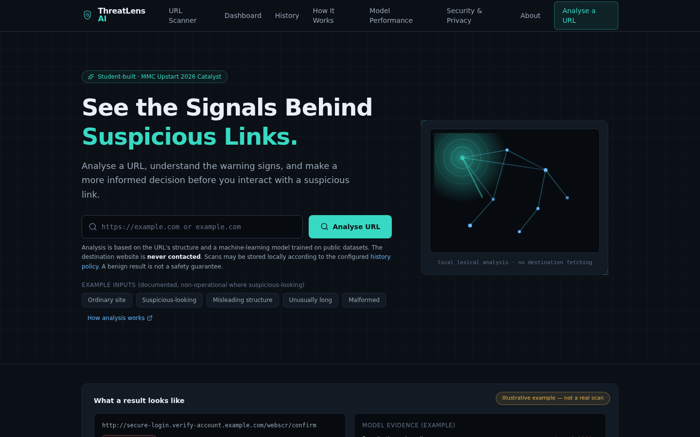
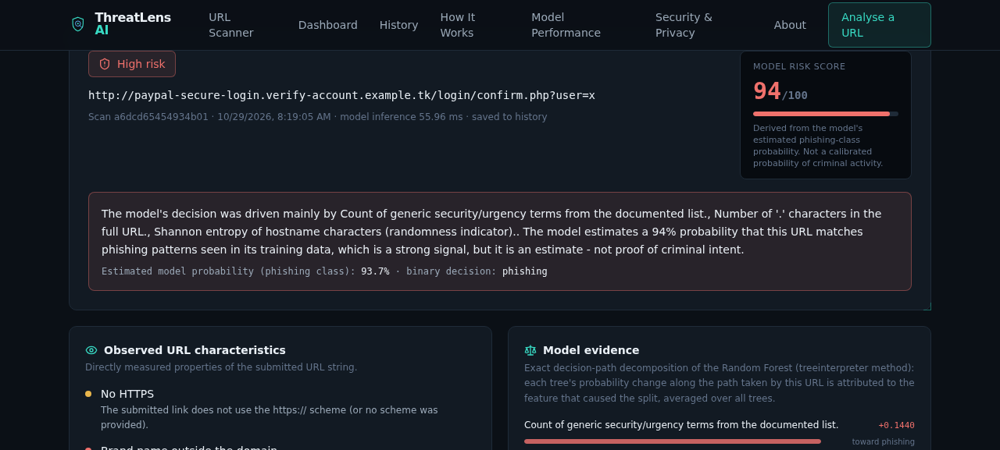
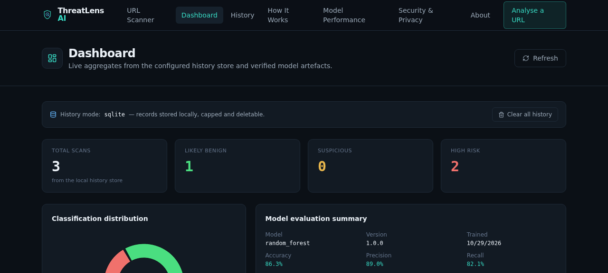

# ThreatLens AI

**Explainable phishing URL detection.**
Student-built cybersecurity prototype · School of Computing & Informatics, Albukhary International University (AIU) · MMC Upstart 2026 Catalyst

ThreatLens AI analyses a submitted URL with a trained machine-learning model, explains **why** the URL received its classification, and gives proportionate safety guidance. The destination website is **never contacted** — the analysis runs on the URL string alone.

> ⚠️ **An assistive screening tool, not a definitive security verdict.** A benign prediction is not a safety guarantee; a phishing prediction is an estimate, not proof. See [docs/SECURITY_AND_PRIVACY.md](docs/SECURITY_AND_PRIVACY.md).

| Landing | Scan result | Dashboard |
|---|---|---|
|  |  |  |

---

## Repository layout

```
.
├── backend/                 FastAPI service (Python 3.12)
│   ├── app/                 API routes, auth, services, ML loading
│   ├── artifacts/           ← trained model artefacts go here (not committed)
│   ├── tests/               pytest suite (trains its own tiny fixture model)
│   ├── scripts/             validate_model.py (deployment gate for artefacts)
│   ├── requirements.txt     runtime dependencies
│   └── requirements-dev.txt test dependencies
├── frontend/                React 19 + TypeScript + Vite + Tailwind SPA
├── supabase/migrations/     Postgres schema + Row Level Security policies
├── docs/                    architecture, model card, security, declarations
├── Dockerfile               single-origin image (API + built SPA)
└── docker-compose.yml
```

## How it works

```
Browser (React SPA) ──Supabase Auth──▶ access token (JWT)
   │  POST /api/scan  Authorization: Bearer <token>
   ▼
FastAPI
   ├─ token verification (JWKS signature / Auth /user fallback)
   ├─ server-side URL validation
   ├─ URL parser ─ no network I/O anywhere in this path
   ├─ shared feature extractor (57 lexical features on a canonical URL, versioned schema)
   ├─ trained scikit-learn model (joblib artefact)
   ├─ explanation service (exact tree-path / coefficient decomposition)
   └─ history store: disabled | memory | sqlite | supabase (RLS-enforced)
```

Full description: [docs/ARCHITECTURE.md](docs/ARCHITECTURE.md).

### Model at a glance

The classifier is built in a reproducible research notebook, kept in the separate **Phishing-url-detection-ML** project, and evaluated on **2,110 URLs from domains it never saw during training**:

| PR-AUC | ROC-AUC | Accuracy | Precision | Recall | Explanations |
|---|---|---|---|---|---|
| 0.945 (95% CI 0.924–0.962) | 0.950 | 0.887 | 0.882 | 0.861 | exact for every URL |

The selected model is a tuned gradient-boosted tree ensemble. It flags 91% of fresh OpenPhish URLs and about 1% of the 1,000 most-linked legitimate domains, and edits that don't change a link's destination (such as adding `www.`) never change its verdict. The study also shows that random train/test splits would have overstated PR-AUC by about 0.03. Details: [docs/MODEL_CARD.md](docs/MODEL_CARD.md).

**Stack:** React 19, TypeScript, Vite, Tailwind CSS 4, Recharts, Framer Motion · Python 3.12, FastAPI, Pydantic, PyJWT · scikit-learn, pandas, NumPy · Supabase Auth + Postgres (RLS) · pytest.

---

## Quick start

Prerequisites: Python 3.11+, Bun 1.1+ (or Node 20+), a Supabase project.

### 1. Backend

```bash
cd backend
python -m venv .venv && source .venv/bin/activate   # Windows: .venv\Scripts\activate
pip install -r requirements-dev.txt
cp .env.example .env                                # fill in SUPABASE_URL / SUPABASE_PUBLISHABLE_KEY
python -m uvicorn app.main:app --host 127.0.0.1 --port 8000
```

API docs (development mode): http://127.0.0.1:8000/api/docs

### 2. Model

**The repository does not ship a trained model.** Until the four artefact files are placed in `backend/artifacts/`, the API runs normally but `POST /api/scan` returns an explicit `503 model_unavailable` — it never fakes a prediction.

To supply a model, copy the artefacts in and validate them:

```bash
cd backend
cp /path/to/your/artifacts/* artifacts/
python scripts/validate_model.py       # exit 0 = safe to serve
```

Or build one with the research notebook in the separate **Phishing-url-detection-ML** project: it downloads the data from its original sources, trains and evaluates the models, and, run with `THREATLENS_BACKEND` set to this repository's `backend/` folder, deploys the selected model into `backend/artifacts/` and validates it. The complete procedure, artefact contract and rollback steps are in [docs/MODEL_DROPIN.md](docs/MODEL_DROPIN.md).

### 3. Frontend

```bash
cd frontend
cp .env.example .env      # VITE_SUPABASE_URL / VITE_SUPABASE_PUBLISHABLE_KEY
bun install
bun run dev               # http://localhost:5173 (proxies /api → :8000)
```

### 4. Single-origin production build

The backend serves a built frontend from `backend/static/` at `/`:

```bash
cd frontend && bun run build
rm -rf ../backend/static && cp -r dist ../backend/static
# restart uvicorn → http://127.0.0.1:8000 serves both the SPA and /api
```

### 5. Docker

```bash
export VITE_SUPABASE_URL=https://<project-ref>.supabase.co
export VITE_SUPABASE_PUBLISHABLE_KEY=<publishable-key>
docker compose up --build   # → http://localhost:8000
```

The image builds the frontend and serves it from the API container. `backend/artifacts/` is mounted read-only and backend settings are read from `backend/.env`.

### 6. Tests

```bash
cd backend
python -m pytest
```

The suite covers feature extraction, the ML train→save→load→infer path (on a small fixture model), the API, history isolation, validation, token verification and the Supabase store. It does not need the real model.

---

## Configuration

Frontend variables are **compiled into the browser bundle at build time**; backend variables are server-side only. Real `.env` files are git-ignored.

**Frontend — `frontend/.env`**

| Variable | Purpose |
|---|---|
| `VITE_SUPABASE_URL` | Supabase project URL (public by design) |
| `VITE_SUPABASE_PUBLISHABLE_KEY` | Supabase **publishable** key. Never a secret/service-role key |
| `VITE_BASE_PATH` | Optional. Sub-path to host the SPA under (default `/`) |

**Backend — `backend/.env`** (template: [backend/.env.example](backend/.env.example))

| Variable | Default | Purpose |
|---|---|---|
| `ENVIRONMENT` | `development` | `production` disables API docs and hides error details |
| `CORS_ORIGINS` | localhost origins | Allow-list for cross-origin frontends |
| `SUPABASE_URL` | *(empty)* | Supabase project URL — required for auth |
| `SUPABASE_PUBLISHABLE_KEY` | *(empty)* | Publishable key only; no privileged key is used anywhere |
| `SUPABASE_AUTH_MODE` | `auto` | `auto` / `jwks` / `userinfo` |
| `SUPABASE_JWT_AUDIENCES` | `authenticated` | Access-token audience allow-list |
| `HISTORY_MODE` | `sqlite` | `disabled` / `memory` / `sqlite` / `supabase` |
| `DATABASE_PATH` | `backend/data/threatlens.db` | SQLite location (sqlite mode only) |
| `HISTORY_RETENTION_LIMIT` | `500` | FIFO cap on stored scans per user |
| `MAX_URL_LENGTH` | `2048` | Input size limit |
| `RATE_LIMIT_SCAN_PER_MINUTE` | `30` | In-process sliding-window limiter |

### Supabase setup

1. Create a project.
2. **SQL Editor** → run [supabase/migrations/0001_init.sql](supabase/migrations/0001_init.sql) (idempotent). It creates `profiles` and `scans`, enables RLS with owner-only policies (`user_id = auth.uid()`), and adds the signup trigger.
3. **Authentication → Providers → Email**: keep *Confirm email* on for production; configure custom SMTP for real use.
4. **Authentication → URL Configuration**: set the *Site URL* and add every environment origin to *Redirect URLs*.
5. *(Optional)* **Google** provider — the frontend detects it automatically and enables the button.

---

## API

| Method & path | Auth | Purpose |
|---|---|---|
| `GET /api/health` | public | Liveness |
| `GET /api/ready` | public | Model + store readiness |
| `GET /api/model-info` | public | Model metadata + headline metrics |
| `GET /api/model-info/metrics` | public | Full evaluation report |
| `POST /api/scan` | Bearer | Analyse a URL → classification, risk score, features, explanation |
| `GET /api/history` | Bearer | List the caller's scans (search / filter / sort / paginate) |
| `GET /api/history/{id}` | Bearer | One stored scan (full result) |
| `DELETE /api/history/{id}` | Bearer | Delete one record |
| `DELETE /api/history` | Bearer | Clear the caller's history |
| `GET /api/dashboard` | Bearer | Aggregates over the caller's records |
| `GET /api/profile` · `PUT /api/profile` | Bearer | Read / update display name |

Errors use one envelope: `{"error": {"code", "message"}}`. Rate limiting returns `429` with `Retry-After`.

**Classification mapping:** phishing-class probability *p* → `high_risk` p ≥ 0.80 · `suspicious` 0.50 ≤ p < 0.80 · `likely_benign` p < 0.50 · uncertainty flag when 0.35 ≤ p ≤ 0.65. Risk score = round(p × 100). Probabilities are uncalibrated estimates.

---

## Security & privacy

- **No destination fetching** — no HTTP client exists in the scan path (SSRF-safe by construction).
- **Verified identity** — protected endpoints accept only cryptographically verified Supabase tokens; user IDs never come from the browser.
- **Database-enforced isolation** — in Supabase mode every query runs under the caller's own JWT, so RLS is the final authority. The backend holds no privileged key.
- Server-side validation, scheme allow-list, length/body limits, security headers, URL-redacting logs.
- Only locally trained artefacts are loaded; a feature-schema mismatch refuses to serve.

Details: [docs/SECURITY_AND_PRIVACY.md](docs/SECURITY_AND_PRIVACY.md).

## Limitations

- URL-lexical analysis only — page content and server behaviour are out of scope by design.
- The classifier makes mistakes in both directions; dataset bias favours popular legitimate sites.
- Phishing evolves; the model needs periodic retraining.
- The rate limiter is per-process (single-instance deployment).
- No threat-intelligence provider is integrated; the status is reported, never simulated.

## Further documentation

| Document | Contents |
|---|---|
| [docs/ARCHITECTURE.md](docs/ARCHITECTURE.md) | Components, scan flow, design decisions |
| [docs/MODEL_DROPIN.md](docs/MODEL_DROPIN.md) | Supplying, training and validating the model |
| [docs/MODEL_CARD.md](docs/MODEL_CARD.md) | Model card |
| [docs/SECURITY_AND_PRIVACY.md](docs/SECURITY_AND_PRIVACY.md) | Threat model and controls |
| [docs/AI_AND_DATA_DECLARATION.md](docs/AI_AND_DATA_DECLARATION.md) | Data sources, licences, AI-tool disclosure |
| [docs/PROJECT_SUMMARY.md](docs/PROJECT_SUMMARY.md) · [docs/DEMO_SCRIPT.md](docs/DEMO_SCRIPT.md) | Competition summary and live-demo flow |

## Team

Developed by a student team at the School of Computing & Informatics, Albukhary International University, for the MMC Upstart 2026 Catalyst competition.

*No institutional endorsement, certification, or partnership is claimed.*
