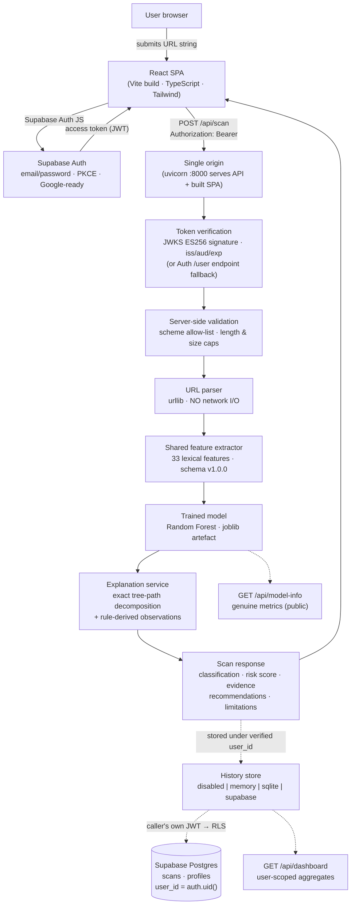

# Architecture — ThreatLens AI

## 1. High-level data flow



Solid path = the mandatory scan flow. Dashed = optional, policy-controlled components. **No arrow ever leaves the deployment at scan time** — there is no external call in the scan path. (Supabase Auth and Postgres are contacted only for authentication and persistence, never as part of URL classification.)

## 2. Component responsibilities

### Frontend (`frontend/`)

- **React 19 + TypeScript + Vite + Tailwind CSS 4.** Hash-based client routing (`/#/scanner`, …) so the production build can be hosted from any static location without server rewrites.
- **Public / private route separation:** public marketing pages (`/`, `/how-it-works`, `/model-performance`, `/security-privacy`, `/about`); auth pages (`/login`, `/signup`, `/forgot-password`, `/auth/callback`, `/auth/reset-password`); private workspace under `/app/*` guarded by `RequireAuth` (waits for the session to resolve — no flash of private content — then redirects to `/login?next=…` with an open-redirect-safe return path).
- `auth/AuthProvider.tsx` — Supabase session restore, `onAuthStateChange` sync, profile loading, personal-state reset on sign-out/account switch, silent token refresh on API 401.
- `auth/authToken.ts` — keeps the current access token out of React state; `services/api.ts` attaches `Authorization: Bearer` to protected calls and normalises the backend's `{"error": {...}}` envelope into typed exceptions; relative URLs only.
- `lib/supabase.ts` — publishable-key browser client (PKCE flow); fetches public `/auth/v1/settings` so the Google button is enabled **only** when the provider is actually configured.
- Pages: Landing, URL Scanner, Dashboard, History, How It Works, Model Performance, Security & Privacy, About, Settings (+ 404).
- Design system in `styles/index.css` (@theme tokens: `#0B1016` background, `#121A23` surfaces, `#38D9C3`/`#66B9FF` accents, semantic red/amber/green used *only* semantically — teal never implies "safe").
- Accessibility: semantic landmarks, skip link, labelled controls, `aria-live` result regions, visible focus rings, `prefers-reduced-motion` honoured for all decorative animation.
- Framer Motion used sparingly (result reveal, contribution-bar growth) and disabled under reduced motion.

### Backend (`backend/app`)

```
app/
├── main.py                 # app factory, lifespan wiring, middleware, error handlers
├── api/                    # thin route modules
│   ├── routes_scan.py      # POST /api/scan (the core flow, auth-protected)
│   ├── routes_health.py    # /api/health, /api/ready (honest state, public)
│   ├── routes_model.py     # /api/model-info, /api/model-info/metrics (public)
│   ├── routes_history.py   # list / get / delete / clear (user-scoped)
│   ├── routes_dashboard.py # user-scoped aggregates
│   └── routes_profile.py   # GET/PUT /api/profile (caller's own row)
├── core/
│   ├── config.py           # pydantic-settings, .env driven
│   ├── auth.py             # Supabase JWT verification: JWKS ES256 + /user fallback,
│   │                       #   reusable get_current_user dependency, 401/403 semantics
│   ├── logging_config.py   # URL-redacting log helpers
│   └── rate_limit.py       # in-process sliding window
├── schemas/scan.py         # Pydantic request/response contracts
├── services/
│   ├── url_parser.py       # structural parse (no I/O)
│   ├── feature_extractor.py# THE shared, versioned feature module
│   ├── inference_service.py# predict_proba → bands, risk score, uncertainty
│   ├── explanation_service.py # exact decomposition + observed characteristics
│   ├── history_service.py  # Null | Memory | SQLite stores behind one interface
│   ├── supabase_store.py   # SupabaseHistoryStore + SupabaseProfileService:
│   │                       #   every Data API call carries the caller's own JWT (RLS)
│   └── reputation_service.py # provider seam (none integrated; honest status)
├── ml/
│   ├── model_loader.py     # trusted-artefact loading + schema guard
│   └── model_metadata.py   # public metadata projection
└── utils/validation.py     # server-side URL validation rules
```

The SQL schema and RLS policies live in `supabase/migrations/0001_init.sql` (idempotent, applied via the Supabase SQL Editor — see README §8.6).

**Training lives outside the app** (`backend/training/`) — the API never trains at startup; it loads artefacts produced by the documented pipeline and refuses to serve if they are missing or schema-mismatched.

## 3. The scan flow, step by step

1. **Validation** (`utils/validation.py`): string type, length ≤ 2048, control characters, scheme allow-list (http/https or documented bare-domain rule), `localhost` rejection.
2. **Parsing** (`services/url_parser.py`): `urllib.parse.urlsplit`; hostname separated from path/query; IDN/punycode preserved; `scheme_was_inferred` recorded for bare domains.
3. **Feature extraction** (`services/feature_extractor.py`): the *same* module imported by the training scripts. 33 features in a fixed order; order drift is asserted against `FEATURE_NAMES`; schema version guards train/serve consistency.
4. **Inference** (`services/inference_service.py`): `predict_proba` on a DataFrame (feature names preserved) → estimated phishing probability → binary decision at 0.5 → documented bands → uncertainty flag → risk score = round(p×100).
5. **Explanation** (`services/explanation_service.py`):
   - *Model evidence:* exact decision-path decomposition for Random Forest (each tree's probability change attributed to the split feature, averaged over trees; verified to reproduce `predict_proba` within 1e-6), or coefficient × standardised-value for Logistic Regression; otherwise an explicitly labelled rule-based fallback. **No numbers are ever invented.**
   - *Observed characteristics:* plain-language statements generated only from features actually present.
   - *Interpretation, recommendations, cannot-determine:* rule-selected per band and per evidence.
6. **Persistence (optional, user-scoped):** `history_service.py` / `supabase_store.py` store the record per `HISTORY_MODE` (`disabled`/`memory`/`sqlite`/`supabase`, FIFO cap 500). In `supabase` mode the insert carries the caller's verified JWT so RLS (`user_id = auth.uid()`) is the final authority; storage failure never breaks a scan response.
7. **Response:** Pydantic-validated `ScanResult` with model version, feature schema version, timestamp, duration, and limitations.

## 4. Cross-cutting design decisions

| Decision | Rationale |
|---|---|
| Hash routing on the SPA | Static hosting without server rewrites (single-origin backend mount or any CDN) |
| One shared feature module | Eliminates train/serve skew by construction; schema-version check is a second guard |
| Stores behind an interface (`HistoryStore`) | SQLite ↔ Supabase Postgres swap without touching routes |
| Least-privilege Supabase access | The backend holds only the publishable key; every query runs under the caller's own JWT so RLS — not server code — enforces ownership. No service-role key exists anywhere |
| JWKS-first token verification | Cryptographic signature check with issuer/audience/expiry; secure `/user`-endpoint fallback for symmetric projects; browser-supplied IDs are never trusted |
| Rate limiter in `core/` with documented scope | Single-instance prototype; swap point named for production |
| Security headers + no-fetch architecture | SSRF-safe by construction; browser never navigates to submitted URLs |

## 5. Deployment views

- **Local development:** `uvicorn app.main:app --port 8000` + `vite dev` (dev proxy forwards `/api`).
- **Single origin (recommended for demo):** `vite build` → copy `dist/` to `backend/static/` → uvicorn serves both SPA and API on :8000.
- **Docker:** the root `Dockerfile` builds the frontend in a Bun stage and copies it into the Python image as `static/`, so one container serves SPA + API on :8000. `docker-compose.yml` mounts `backend/artifacts/` read-only and keeps the SQLite file on a named volume.
